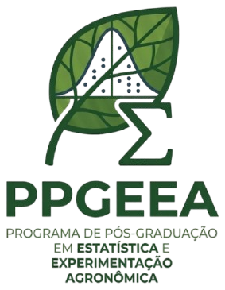

I am an Agricultural Engineer from Colombia, with an MBA in Data Science and Analytics (USP) and a Master's degree in Genetics and Plant Breeding (UFLA). I am currently a PhD student in **Statistics and Agricultural Experimentation** at ESALQ/USP, with a CAPES scholarship, and I am also taking an **MBA in Agribusiness** (ESALQ/USP) and a **specialization in Artificial and Computational Intelligence** (UFV).

My research sits where agriculture, statistics and artificial intelligence meet. In my PhD I am using **Genetic Programming** to build new agricultural indices from experimental data. I also develop methods that use **information theory** (mutual information and Shannon entropy) to make genomic selection and genotype-by-environment (G×E) analysis more interpretable.

I have supported a wheat breeding program in subtropical conditions, analysed time series of agricultural crop prices, worked on G×E interaction and experimental analysis, and collaborated on research projects on rose growth. I am also a biostatistics teaching assistant.

## What I do

| Area | Methods and tools |
|---|---|
| **Quantitative genetics** | Genomic selection (GBLUP), G×E, multi-environment trials, factor-analytic models, adaptability and stability (GGE, MTSI) |
| **Statistical modelling** | Linear mixed models (ASReml, lme4), Bayesian hierarchical models (Stan), spatial field-trial analysis, experimental design |
| **Information theory** | Mutual information and Shannon entropy for marker selection, G×E networks and stability |
| **Time series and spatial** | ARIMA/SARIMA, Prophet, geostatistics and kriging, vegetation indices from imagery |
| **Machine learning** | CNNs for plant disease detection, Random Forest, clustering, PCA, factor analysis, GLM, Genetic Programming |
| **Reproducible science** | R, Python, Quarto/R Markdown, Git and GitHub, GitHub Actions, Zenodo |

## Education

::: {.affiliations}
[{fig-alt="ESALQ – Luiz de Queiroz College of Agriculture, University of São Paulo"}](https://www.esalq.usp.br){.aff title="ESALQ – University of São Paulo"}
[{fig-alt="PPGEEA – Graduate Program in Statistics and Agricultural Experimentation"}](https://www.esalq.usp.br/pg/programas/estatistica/){.aff title="PPGEEA – Graduate Program in Statistics and Agricultural Experimentation"}
[Luiz de Queiroz College of Agriculture (**ESALQ**), University of São Paulo · Graduate Program in Statistics and Agricultural Experimentation (**PPGEEA**)]{.aff-text}
:::

::: {.timeline}
::: {.item}
**PhD in Statistics and Agricultural Experimentation** · Universidade de São Paulo (ESALQ/USP)\
[2025 – present · CAPES scholarship]{.when}
:::
::: {.item}
**Specialization in Artificial and Computational Intelligence** · Universidade Federal de Viçosa (UFV)\
[2026 – present]{.when}
:::
::: {.item}
**MBA in Agribusiness** · Universidade de São Paulo (ESALQ/USP)\
[2026 – present]{.when}
:::
::: {.item}
**MSc in Genetics and Plant Breeding** · Universidade Federal de Lavras (UFLA)\
[2022 – 2024 · Dissertation on adaptability and stability of wheat cultivars in Minas Gerais]{.when}
:::
::: {.item}
**MBA in Data Science and Analytics** · Universidade de São Paulo (USP)\
[2020 – 2022 · Final project: Tahiti lemon price forecasting]{.when}
:::
::: {.item}
**Agronomic Engineering** · Universidad Nacional de Colombia\
[2013 – 2020]{.when}
:::
:::

## Languages

Spanish (native) · Portuguese · English

## Contact

The best way to reach me is by [email](mailto:raruizc@usp.br) or [LinkedIn](https://www.linkedin.com/in/ricardo-ruiz-cardozo/). My code is on [GitHub](https://github.com/raruizc) and my publications are on [ORCID](https://orcid.org/0009-0003-9162-8396).
