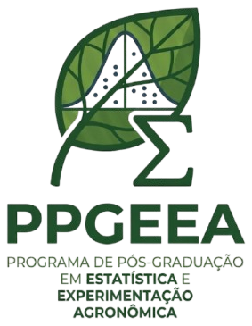

**I turn field-trial and genomic data into better selection decisions.**

I am a PhD candidate in Statistics and Agricultural Experimentation at ESALQ/USP (Brazil). I work where agriculture, statistics and artificial intelligence meet: mixed models, Bayesian hierarchical models, information theory and machine learning applied to plant breeding and agricultural data.

::: {.highlights}
::: {.highlight}
[1st place]{.big}
[GDM Universities Challenge (best ESALQ project) with MIBLUP]{.small}
:::
::: {.highlight}
[2 papers]{.big}
[Published in 2025 on wheat adaptability and field-trial design]{.small}
:::
::: {.highlight}
[PhD · MSc · MBA]{.big}
[Statistics (ESALQ/USP), Plant Breeding (UFLA), Data Science (USP), Agribusiness (ESALQ/USP), AI specialization (UFV)]{.small}
:::
::: {.highlight}
[ES · PT · EN]{.big}
[Spanish, Portuguese and English]{.small}
:::
:::

[[]{.bi .bi-grid-3x3-gap} See my projects](projects/index.qmd){.btn-pill .solid} [[]{.bi .bi-journal-text} Research](research.qmd){.btn-pill} [[]{.bi .bi-person} About me](about.qmd){.btn-pill}

::: {.affiliations}
[{fig-alt="ESALQ – Luiz de Queiroz College of Agriculture, University of São Paulo"}](https://www.esalq.usp.br){.aff title="ESALQ – University of São Paulo"}
[{fig-alt="PPGEEA – Graduate Program in Statistics and Agricultural Experimentation"}](https://www.esalq.usp.br/pg/programas/estatistica/){.aff title="PPGEEA – Graduate Program in Statistics and Agricultural Experimentation"}
[PhD candidate at the **Graduate Program in Statistics and Agricultural Experimentation (PPGEEA)**, ESALQ, University of São Paulo]{.aff-text}
:::

### Deep dives

Theory, equations and the real code behind my projects:

::: {.deep-dives}
[[]{.bi .bi-diagram-3} **MIBLUP** [Mutual information inside the mixed model]{.dd-sub} [Explore →]{.dd-go}](projects/miblup/index.qmd){.dd}
[[]{.bi .bi-globe-europe-africa} **Nordic barley G×E** [Factor-analytic models, information and entropy]{.dd-sub} [Explore →]{.dd-go}](projects/nordic-barley/index.qmd){.dd}
[[]{.bi .bi-graph-up-arrow} **Tahiti lemon prices** [SARIMA forecasting with interactive plots]{.dd-sub} [Explore →]{.dd-go}](projects/tahiti-lemon/index.qmd){.dd}
[[]{.bi .bi-camera} **Tomato disease CNN** [Deep learning on leaf photos, layer by layer]{.dd-sub} [Explore →]{.dd-go}](projects/tomato-disease/index.qmd){.dd}
[[]{.bi .bi-map} **AgriRaster** [Vegetation indices, kriging and clustering]{.dd-sub} [Explore →]{.dd-go}](projects/agriraster/index.qmd){.dd}
:::