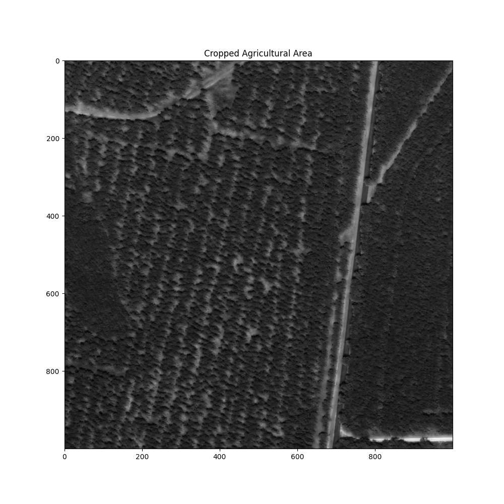
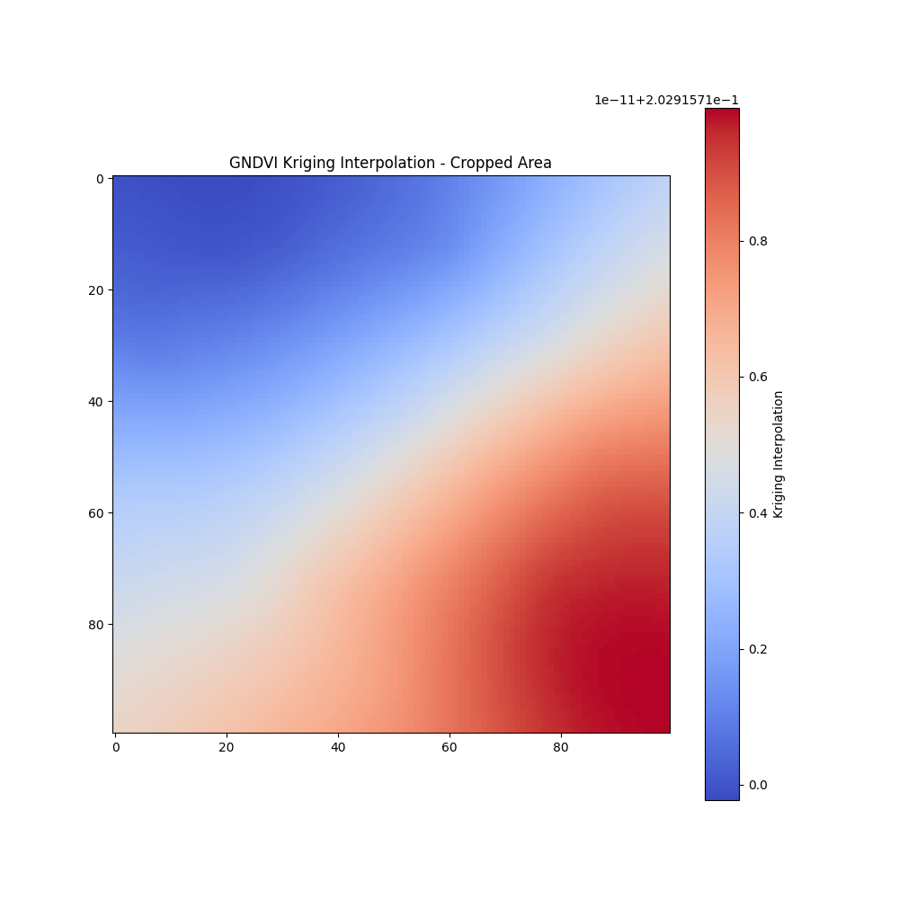
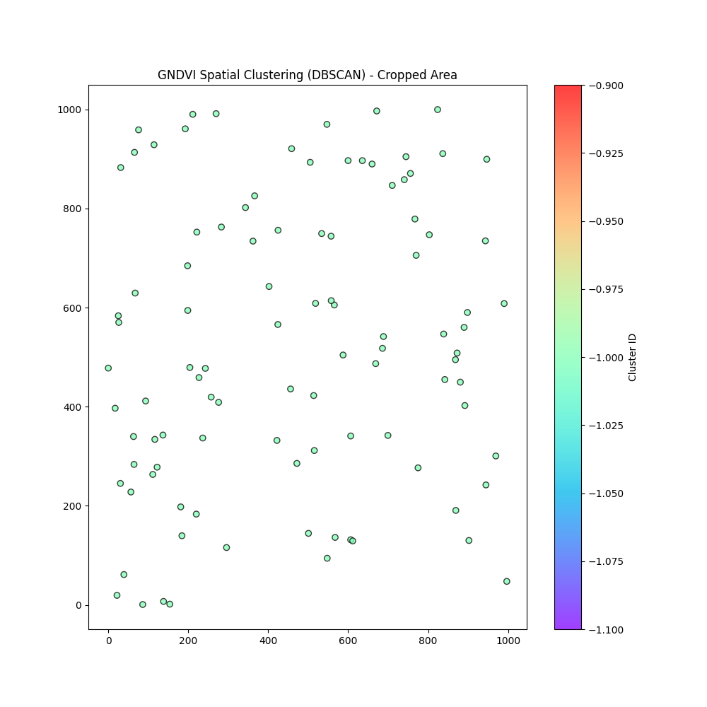

[[]{.bi .bi-github} Code on GitHub](https://github.com/raruizc/AgriRaster){.btn-pill .solid} [[]{.bi .bi-journal-code} Notebook](https://github.com/raruizc/AgriRaster/blob/main/AgriRaster.ipynb){.btn-pill}

::: {.stats}
::: {.stat}
[1000 × 1000]{.stat-num}
[pixel region of interest from a drone image]{.stat-label}
:::
::: {.stat}
[3 methods]{.stat-num}
[vegetation index · kriging · DBSCAN]{.stat-label}
:::
::: {.stat}
[100 × 100]{.stat-num}
[kriging prediction grid]{.stat-label}
:::
::: {.stat}
[Open data]{.stat-num}
[imagery from OpenAerialMap]{.stat-label}
:::
:::

## The problem

Fields are not uniform: soil, water and nutrients vary within a few metres. **Precision agriculture** splits a field into **management zones** so that fertilizer, water or sampling can go where they are needed. This notebook is a compact prototype of that workflow, from a raw aerial image to a smooth vegetation map and spatial groups.

## Pipeline architecture

```{mermaid}
flowchart LR
  A[OpenAerialMap<br/>drone GeoTIFF] --> B[rasterio<br/>read bands]
  B --> C[Crop window<br/>1000 × 1000 px]
  C --> D[Vegetation index<br/>per pixel]
  D --> E[Sample 100<br/>random points]
  E --> F[Ordinary kriging<br/>linear variogram]
  F --> G[Smooth index map<br/>100 × 100 grid]
  E --> H[DBSCAN<br/>eps = 50, minPts = 5]
  H --> I[Spatial clusters]
```

Reading only a **window** of the raster (`rasterio.windows.Window`) keeps memory low: drone mosaics can be several gigabytes, but only the cropped area is loaded.

## Theory

### 1. Vegetation indices

Healthy leaves absorb red light for photosynthesis and reflect near-infrared (NIR) and some green. Indices turn band reflectances $\rho$ into a single number per pixel between −1 and 1:

$$
\text{NDVI} = \frac{\rho_{NIR} - \rho_{Red}}{\rho_{NIR} + \rho_{Red}},
\qquad
\text{GNDVI} = \frac{\rho_{NIR} - \rho_{Green}}{\rho_{NIR} + \rho_{Green}},
\qquad
\text{GRVI} = \frac{\rho_{Green} - \rho_{Red}}{\rho_{Green} + \rho_{Red}}.
$$

The image used here is a standard **RGB** drone image with no NIR band, so the notebook computes the green–red index (GRVI, labelled "GNDVI" in the code): positive values mean green vegetation, negative values bare soil or senescent plants.

### Interactive: compare the indices

Move the sliders to set the reflectance of a pixel in each band.

```{ojs}
//| echo: false
viewof red   = Inputs.range([0.01, 0.6], {step: 0.01, value: 0.08, label: "Red reflectance"})
viewof green = Inputs.range([0.01, 0.6], {step: 0.01, value: 0.12, label: "Green reflectance"})
viewof nir   = Inputs.range([0.01, 0.8], {step: 0.01, value: 0.45, label: "NIR reflectance"})
indices = [
  {index: "NDVI",  value: (nir - red) / (nir + red)},
  {index: "GNDVI", value: (nir - green) / (nir + green)},
  {index: "GRVI (used here, RGB only)", value: (green - red) / (green + red)}
]
Plot.plot({
  height: 170, marginLeft: 190, width: Math.max(width, 480),
  style: {fontSize: "13px"},
  x: {domain: [-1, 1], grid: true, label: "index value"},
  y: {label: null},
  color: {type: "diverging", scheme: "RdYlGn", domain: [-1, 1]},
  marks: [
    Plot.ruleX([0]),
    Plot.barX(indices, {x: "value", y: "index", fill: "value"}),
    Plot.text(indices, {x: "value", y: "index", text: d => d.value.toFixed(2),
                        dx: 18, fontWeight: "bold"})
  ]
})
```

Try a healthy canopy (red 0.05, green 0.10, NIR 0.50) and bare soil (red 0.25, green 0.20, NIR 0.30): NDVI separates them much more strongly than GRVI, which is why a multispectral camera is worth it.

### 2. The semivariogram

Geostatistics assumes that nearby points are more alike than distant ones. The empirical semivariogram measures how dissimilar two points are as a function of their distance $h$:

$$
\hat\gamma(h) = \frac{1}{2\,N(h)} \sum_{(i,j):\ \lVert s_i - s_j\rVert \approx h} \left[z(s_i) - z(s_j)\right]^2 .
$$

A model is then fitted to it. The notebook uses the **linear** model, $\gamma(h) = c_0 + b\,h$, where the nugget $c_0$ is small-scale noise and the slope $b$ says how quickly similarity fades with distance.

### 3. Ordinary kriging

Kriging predicts the index at an unsampled location $s_0$ as a weighted average of the sampled points:

$$
\hat z(s_0) = \sum_{i=1}^{n} \lambda_i\, z(s_i), \qquad \sum_{i=1}^{n}\lambda_i = 1 .
$$

The weights are the **best linear unbiased** choice: they minimize the prediction variance under the unbiasedness constraint. With a Lagrange multiplier $\mu$ this gives the kriging system

$$
\begin{bmatrix} \boldsymbol\Gamma & \mathbf 1 \\ \mathbf 1^\top & 0 \end{bmatrix}
\begin{bmatrix} \boldsymbol\lambda \\ \mu \end{bmatrix}
=
\begin{bmatrix} \boldsymbol\gamma_0 \\ 1 \end{bmatrix},
\qquad
\sigma^2_{OK}(s_0) = \boldsymbol\lambda^\top \boldsymbol\gamma_0 + \mu ,
$$

where $\Gamma_{ij} = \gamma(\lVert s_i - s_j\rVert)$ and $\gamma_{0i} = \gamma(\lVert s_0 - s_i\rVert)$. Kriging is the spatial version of BLUP, the same idea behind the mixed models in my genetics work. It also returns the **kriging variance** $\sigma^2_{OK}$, a map of where the prediction is uncertain.

### 4. DBSCAN clustering

DBSCAN groups points that are densely packed and marks isolated points as noise, without fixing the number of clusters in advance. With radius $\varepsilon$ and a minimum count `minPts`:

$$
N_\varepsilon(p) = \{\, q : \lVert p - q \rVert \le \varepsilon \,\},
\qquad
p \text{ is a core point} \iff |N_\varepsilon(p)| \ge \text{minPts}.
$$

Clusters grow by connecting core points that lie in each other's neighbourhoods; points reachable from no core point are labelled noise (−1).

## From the theory to Python

Condensed from `AgriRaster.ipynb`. Hover over the numbers to link each line to the theory.

```python
raster = rasterio.open("Data/drone_image_1.tif")
x_off = (raster.width - 1000) // 2
y_off = (raster.height - 1000) // 2
window = Window(x_off, y_off, 1000, 1000)                    # <1>

red   = raster.read(1, window=window).astype(float)
green = raster.read(2, window=window).astype(float)
index = (green - red) / (green + red)                        # <2>

x = np.random.rand(100) * index.shape[1]                     # <3>
y = np.random.rand(100) * index.shape[0]
z = index[y.astype(int), x.astype(int)]

gridx = np.linspace(0, index.shape[1], 100)
gridy = np.linspace(0, index.shape[0], 100)
OK = OrdinaryKriging(x, y, z, variogram_model="linear")      # <4>
z_kriged, ss = OK.execute("grid", gridx, gridy)              # <5>

coords = np.column_stack((x, y))
labels = DBSCAN(eps=50, min_samples=5).fit(coords).labels_   # <6>
```
1. Central 1000 × 1000 pixel window: only this part of the image is read into memory.
2. Green–red index per pixel (section 1). Band 1 is red and band 2 is green in this RGB image.
3. 100 random sample locations and their index values: the "observations" for geostatistics.
4. Fits the linear semivariogram $\gamma(h) = c_0 + b\,h$ (section 2).
5. Solves the kriging system for every cell of a 100 × 100 grid (section 3). `ss` is the kriging variance $\sigma^2_{OK}$.
6. DBSCAN with $\varepsilon = 50$ pixels and minPts = 5 (section 4).

## Results

::: {.panel-tabset}
## Region of interest

{.lightbox}

## Kriged index

{.lightbox}

## DBSCAN clusters

{.lightbox}
:::

## Limitations and next steps

This notebook is a learning prototype. Being clear about what it does and does not do:

- **True NDVI needs NIR.** With an RGB image the green–red index is a proxy. A multispectral drone (with NIR and red-edge bands) or Sentinel-2 would give real NDVI and GNDVI.
- **Clusters use position only.** DBSCAN here groups the sample points by location, not by vegetation index, so the clusters show where samples are dense rather than zones of similar vigour. Real management zones should cluster on the index values together with scaled coordinates, for example k-means or DBSCAN on $(x, y, \hat z)$ from the kriged map.
- **Variogram choice.** The linear model was fixed in advance; comparing spherical, exponential and Gaussian models by cross-validation would be more rigorous.
- **More samples, regular design.** 100 random points is small for a 1000 × 1000 area; a regular or stratified grid, and plotting the kriging variance map, would show where predictions are reliable.
- **Edge cases.** Pixels where green + red = 0 (pure black) should be masked to avoid division by zero.

**Skills shown:** raster processing, vegetation indices, geostatistics (variogram, ordinary kriging), unsupervised learning, Python (`rasterio`, `pykrige`, `scikit-learn`, `numpy`).
