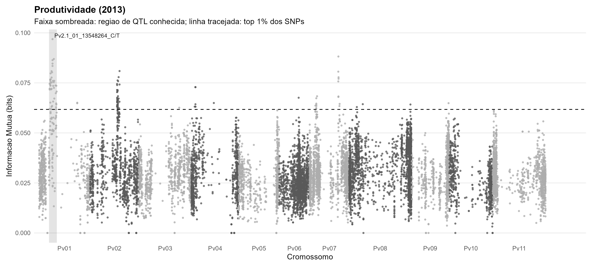
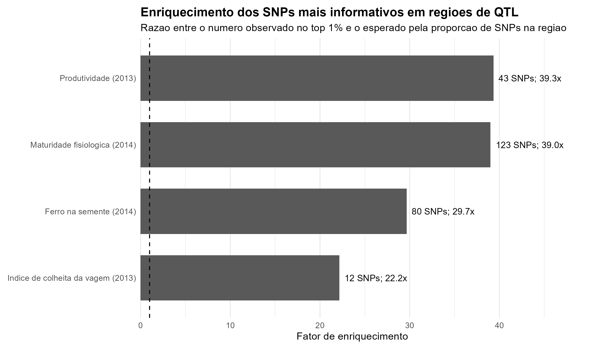
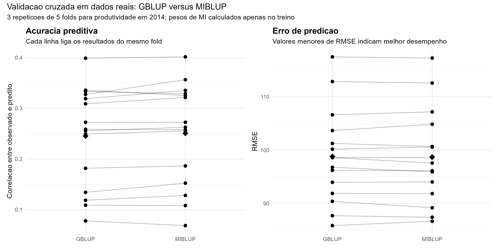
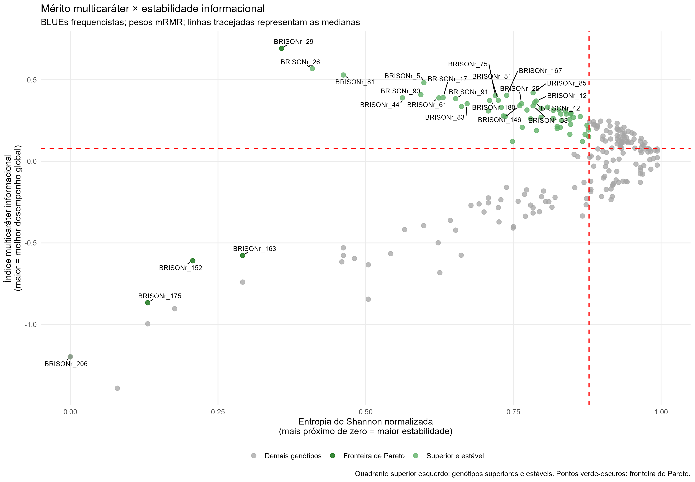

[[]{.bi .bi-github} Code on GitHub](https://github.com/raruizc/MIBLUP){.btn-pill .solid} [[]{.bi .bi-file-earmark-code} Simulacao_MI.R](https://github.com/raruizc/MIBLUP/blob/main/Simulacao_MI.R){.btn-pill}

::: {.key-result}
🏆 **1st place, best ESALQ/USP project, GDM Universities Challenge.** Joint work with Cristian Marcelo Villegas Lobos and Marcelo Andrade da Silva (ESALQ/USP), also presented orally at the 70th RBras meeting.
:::

::: {.stats}
::: {.stat}
[+0.252]{.stat-num data-count="0.252" data-prefix="+"}
[gain in accuracy vs GBLUP, cor(ŷ, g)]{.stat-label}
:::
::: {.stat}
[12/12]{.stat-num}
[simulated scenarios where MIBLUP beats GBLUP]{.stat-label}
:::
::: {.stat}
[66%]{.stat-num data-count="66" data-suffix="%"}
[of Random Forest's gain, at 1/5 of its time]{.stat-label}
:::
::: {.stat}
[9.1×]{.stat-num data-count="9.1" data-suffix="×"}
[QTL enrichment among the top 5% MI markers]{.stat-label}
:::
:::

## The problem

Genomic selection with **GBLUP** (VanRaden, 2008) rests on the infinitesimal model: infinitely many genes, each with a tiny, additive effect. Real traits such as yield, drought tolerance or disease resistance often mix a few **major genes** with **epistasis**. GBLUP then spreads the signal of the important loci across thousands of irrelevant markers.

Machine learning (Random Forest, deep learning) and Bayesian mixture models (BayesB, BayesR) capture these patterns, but they cost hours or days of computing, which slows the breeding cycle. **MIBLUP** is a bridge: it brings the marker-level signal of information theory into the GBLUP mixed model without changing its algebra or its speed.

## Theory

### 1. Mutual information

For a SNP genotype $X \in \{0,1,2\}$ and the training phenotype $Y$ discretized into 10 equal-width classes, the mutual information is how much knowing the genotype reduces the uncertainty about the phenotype:

$$
I(X;Y) = H(X) + H(Y) - H(X,Y)
$$

with the Shannon entropies

$$
\begin{aligned}
H(X)   &= -\sum_x p(x)\log_2 p(x) \\
H(Y)   &= -\sum_y p(y)\log_2 p(y) \\
H(X,Y) &= -\sum_{x,y} p(x,y)\log_2 p(x,y)
\end{aligned}
$$

::: {.callout-note}
## Why not correlation?
$I(X;Y) = 0 \iff X$ and $Y$ are independent. Unlike Pearson correlation, MI does not assume a linear relationship: it picks up additive, dominance or any other pattern between genotype classes and phenotype classes.
:::

### 2. From information to marker weights

Each SNP $j$ gets a weight proportional to its information, normalized by the mean:

$$
w_j = \frac{I_j}{\bar I}, \qquad \bar I = \frac{1}{m}\sum_{k=1}^{m} I_k
\quad\Longrightarrow\quad \sum_{j=1}^{m} w_j = m .
$$

With $\mathbf W = \operatorname{diag}(w_1,\dots,w_m)$ and $\mathbf Z$ the genotype matrix centred by allele frequency, the MI-weighted genomic relationship matrix is

$$
\mathbf G_{MI} \propto \mathbf Z \mathbf W \mathbf Z^\top
\qquad \text{vs.} \qquad
\mathbf G = \frac{\mathbf Z \mathbf Z^\top}{2\sum_j p_j(1-p_j)} .
$$

### 3. Proof: MIBLUP is still a mixed model

::: {.callout-tip collapse="true"}
## Show the derivation (4 steps)

::: {.proof-step}
[1]{.step-n} **The model the code fits.** An ordinary mixed model with re-weighted columns:
$$
\mathbf y = \mathbf 1\mu + \tilde{\mathbf Z}\mathbf u + \mathbf e,\qquad
\tilde{\mathbf Z} = \mathbf Z\mathbf W^{1/2},\quad
\mathbf u \sim N(\mathbf 0, \mathbf I\sigma^2_u),\quad
\mathbf e \sim N(\mathbf 0, \mathbf I\sigma^2_e).
$$
:::

::: {.proof-step}
[2]{.step-n} **MI becomes a prior variance per marker.** Reparametrize $\boldsymbol\beta = \mathbf W^{1/2}\mathbf u$:
$$
\boldsymbol\beta \sim N(\mathbf 0, \mathbf W\sigma^2_u), \qquad \operatorname{Var}(\beta_j) = w_j\,\sigma^2_u .
$$
:::

::: {.proof-step}
[3]{.step-n} **Equivalence with GBLUP on $\mathbf G_{MI}$.** At the level of individuals, $\mathbf g = \mathbf Z\boldsymbol\beta$:
$$
\mathbf g \sim N\!\left(\mathbf 0,\ \mathbf Z\mathbf W\mathbf Z^\top\sigma^2_u\right) = N\!\left(\mathbf 0,\ \mathbf G_{MI}\,\sigma^2_g\right),
\qquad \sigma^2_g = \sigma^2_u \cdot 2\sum_j w_j p_j q_j .
$$
So weighted SNP-BLUP and GBLUP with $\mathbf G_{MI}$ give the same BLUPs of $\mathbf g$.
:::

::: {.proof-step}
[4]{.step-n} **Ridge form: selective shrinkage.**
$$
\hat{\boldsymbol\beta} = \arg\min_{\boldsymbol\beta}\ \lVert \mathbf y - \mathbf 1\mu - \mathbf Z\boldsymbol\beta\rVert^2 + \lambda\sum_j \frac{\beta_j^2}{w_j},
\qquad \lambda = \frac{\sigma^2_e}{\sigma^2_u}.
$$
Each SNP has its own penalty $\lambda / w_j$.
:::
:::

### 4. Three consequences

| Result | Meaning |
|---|---|
| $\mathbf W = \mathbf I \Rightarrow$ GBLUP | GBLUP is a special case. MIBLUP generalizes it inside the mixed model: REML, BLUP, `vm(gid, G_MI)` in ASReml. |
| $\sum_j w_j = m$ | The variance "budget" equals GBLUP's: MI **redistributes** variance among markers, it does not inflate it. |
| penalty $\lambda / w_j$ | Informative SNPs are shrunk little; noise SNPs ($w_j \to 0$) are shrunk to zero. |

::: {.callout-warning}
## Honest caveat
$\mathbf W$ is estimated from $\mathbf y$. That is why MI is computed **only on the training set** of each partition, and BLUP properties hold conditionally on $\mathbf W$ (an empirical two-stage approach).
:::

## From the equations to R

The implementation is literally the formulas. Hover over the numbers to see which equation each line implements.

```r
calc_mi_discrete <- function(x, y_disc) {
  px  <- prop.table(table(x))                       # <1>
  py  <- prop.table(table(y_disc))                  # <1>
  pxy <- prop.table(table(x, y_disc))               # <1>

  px  <- px[px > 0]; py <- py[py > 0]; pxy <- pxy[pxy > 0]  # <2>
  Hx  <- -sum(px  * log2(px))                       # <3>
  Hy  <- -sum(py  * log2(py))                       # <3>
  Hxy <- -sum(pxy * log2(pxy))                      # <3>

  max(0, Hx + Hy - Hxy)                             # <4>
}

compute_mi_weights <- function(Z_train, y_train, n_bins = 10, eps = 1e-8) {
  y_disc <- cut(y_train, breaks = n_bins, labels = FALSE,
                include.lowest = TRUE)              # <5>
  mi <- apply(Z_train, 2, function(snp) calc_mi_discrete(snp, y_disc))
  w  <- if (mean(mi) <= eps) rep(1, length(mi)) else mi / mean(mi)  # <6>
  list(mi = mi, weights = pmax(w, eps))
}
```
1. Probabilities $p(x)$, $p(y)$ and $p(x,y)$: relative frequencies of the 3 SNP classes, the 10 phenotype classes and their cross-table.
2. Empty cells are dropped: the convention $0 \log 0 = 0$.
3. Entropies $H = -\sum p \log_2 p$.
4. $I(X;Y) = H(X) + H(Y) - H(X,Y)$, truncated at zero for numerical safety.
5. Phenotype discretized into 10 equal-width classes, built **only from training data**.
6. Weights $w_j = I_j / \bar I$, so $\sum_j w_j = m$; the floor `eps` avoids weights of exactly zero.

Fitting MIBLUP is GBLUP plus one line:

```r
fit_miblup <- function(Z_train, y_train, Z_test, n_bins = 10) {
  w <- compute_mi_weights(Z_train, y_train, n_bins)$weights   # <1>

  Zw_train <- sweep(Z_train, 2, sqrt(w), `*`)                 # <2>
  Zw_test  <- sweep(Z_test,  2, sqrt(w), `*`)                 # <2>

  fit  <- rrBLUP::mixed.solve(y = y_train, Z = Zw_train)      # <3>
  pred <- as.numeric(fit$beta) + as.numeric(Zw_test %*% fit$u) # <4>
  list(pred = pred, weights = w)
}

# ASReml-R: the same idea as a relationship matrix
# random = ~ vm(gid, G_MI)                                    # <5>
```
1. No leakage: $w = f(\mathbf Z_{train}, \mathbf y_{train})$, from the 80% training set of each replicate only.
2. Reparametrization $\tilde{\mathbf Z} = \mathbf Z\mathbf W^{1/2}$, so $\tilde{\mathbf Z}\tilde{\mathbf Z}^\top = \mathbf Z\mathbf W\mathbf Z^\top$ (step 1 of the proof).
3. The same REML + BLUP solver as GBLUP: no new algorithm. $\mathbf u \sim N(\mathbf 0, \mathbf I\sigma^2_u) \Rightarrow \boldsymbol\beta \sim N(\mathbf 0, \mathbf W\sigma^2_u)$.
4. Prediction $\hat{\mathbf y} = \hat\mu + \tilde{\mathbf Z}_{test}\hat{\mathbf u}$, applying the training weights to the test genotypes.
5. In relationship-matrix form, swap $\mathbf G$ for $\mathbf G_{MI}$; this also works in multi-trait `us(trait)` and multi-environment `fa(env)` models.

## Pipeline architecture

```{mermaid}
flowchart LR
  A[SNP matrix 0/1/2] --> B[Centre by allele<br/>frequency, VanRaden]
  B --> C{80 / 20 split}
  C -->|train| D[Discretize y<br/>10 classes]
  D --> E[MI per SNP<br/>I = Hx + Hy − Hxy]
  E --> F[Weights<br/>w = I / mean I]
  F --> G[Z · sqrt w]
  G --> H[rrBLUP::mixed.solve<br/>REML + BLUP]
  C -->|test| I[Z_test · sqrt w]
  H --> J[Predictions]
  I --> J
  J --> K[cor y, cor g, RMSE,<br/>time, QTL enrichment]
```

## Simulation study

A Monte Carlo study with **12 scenarios × 100 replicates** compared GBLUP, MIBLUP and Random Forest (300 trees). Scenarios varied the number of individuals (600–1000), SNPs (1500–2000), genetic architecture (additive, additive + epistasis, sparse), heritability (0.3, 0.6), causal QTLs (10, 30) and multiplicative epistasis (0, 1.2).

### Interactive: accuracy by scenario

Each row is a scenario, sorted by gain. Tick the box to compare with Random Forest.

```{ojs}
//| echo: false
sims = [
  {s:"C9",  arch:"add+epi · h² 0.6 · 10 QTL", GBLUP:0.416, MIBLUP:0.770, RF:0.854},
  {s:"C11", arch:"add+epi · h² 0.6 · 10 QTL", GBLUP:0.476, MIBLUP:0.819, RF:0.868},
  {s:"C6",  arch:"sparse · h² 0.6 · 10 QTL",  GBLUP:0.374, MIBLUP:0.707, RF:0.837},
  {s:"C10", arch:"add+epi · h² 0.3 · 10 QTL", GBLUP:0.347, MIBLUP:0.635, RF:0.792},
  {s:"C4",  arch:"add+epi* · h² 0.6 · 10 QTL", GBLUP:0.301, MIBLUP:0.585, RF:0.787},
  {s:"C1",  arch:"add+epi* · h² 0.6 · 10 QTL", GBLUP:0.372, MIBLUP:0.648, RF:0.791},
  {s:"C8",  arch:"add+epi · h² 0.3 · 10 QTL", GBLUP:0.296, MIBLUP:0.546, RF:0.764},
  {s:"C12", arch:"sparse · h² 0.6 · 30 QTL",  GBLUP:0.481, MIBLUP:0.721, RF:0.727},
  {s:"C3",  arch:"add+epi · h² 0.3 · 10 QTL", GBLUP:0.260, MIBLUP:0.477, RF:0.730},
  {s:"C5",  arch:"add+epi · h² 0.6 · 30 QTL", GBLUP:0.388, MIBLUP:0.582, RF:0.661},
  {s:"C7",  arch:"sparse · h² 0.3 · 30 QTL",  GBLUP:0.355, MIBLUP:0.491, RF:0.576},
  {s:"C2",  arch:"additive · h² 0.3 · 30 QTL", GBLUP:0.260, MIBLUP:0.362, RF:0.498}
]
viewof showRF = Inputs.toggle({label: "Show Random Forest", value: false})
long = sims.flatMap(d => ["GBLUP", "MIBLUP", ...(showRF ? ["RF"] : [])]
  .map(m => ({scenario: `${d.s} · ${d.arch}`, model: m, value: d[m]})))
Plot.plot({
  marginLeft: 200, height: 460, width: Math.max(width, 560),
  style: {fontSize: "13px"},
  x: {domain: [0.2, 0.9], label: "cor(ŷ, g) on the test set, mean of 100 replicates", grid: true},
  y: {domain: sims.map(d => `${d.s} · ${d.arch}`), label: null},
  color: {domain: ["GBLUP", "MIBLUP", "RF"], range: ["#98A3A6", "#2e7d4f", "#B97F14"], legend: true},
  marks: [
    Plot.link(sims, {x1: "GBLUP", x2: "MIBLUP", y: d => `${d.s} · ${d.arch}`, stroke: "#A9CF7C", strokeWidth: 5}),
    Plot.dot(long, {x: "value", y: "scenario", fill: "model", r: 6, tip: true,
                    symbol: d => d.model === "RF" ? "diamond" : "circle"})
  ]
})
```

[\* multiplicative epistasis. Values are scenario means read from the presentation results, rounded to 3 decimals.]{.small}

### Accuracy vs computing cost

| Model | cor(ŷ, y) | cor(ŷ, g) | RMSE | Time per fit (s) |
|---|---|---|---|---|
| GBLUP | 0.251 | 0.360 | 5.024 | 2.2 |
| **MIBLUP** | **0.426** | **0.612** | **4.699** | **5.2** |
| Random Forest | 0.510 | 0.740 | 4.653 | 26.2 |

MIBLUP was better than GBLUP in **97–100% of the replicates** of every scenario (paired t-test, p ≤ 10⁻²⁹). Random Forest is still more accurate, but MIBLUP recovers about **66%** of its gain over GBLUP with **one fifth** of its time, and it stays a mixed model with variance components, BLUPs and per-marker interpretation. The smallest gain was in the purely additive scenario with 30 QTLs (C2), the closest to the infinitesimal model, as theory predicts.

### Interpretability: QTL enrichment

Among the top 5% of SNPs ranked by MI, causal QTLs appeared on average **9.1×** more often than by chance (range 4.1× to 12.6×). Breeders get a GWAS-like map for free during genomic prediction.

## Real data

::: {.panel-tabset}
## MAGIC common bean (CIAT)

444–602 lines × ~12,200 SNPs (Diaz et al., 2020). The top-1% MI markers fall in previously mapped QTL regions **22–39× more often than chance** for yield, maturity, seed iron and pod harvest index. Prediction of yield (3 × 5-fold CV): MIBLUP r = 0.251 vs GBLUP r = 0.245, the same accuracy with interpretable weights.

{.lightbox}

## QTL enrichment

{.lightbox}

## Cross-validation

{.lightbox}

## German wheat (BRIWECS)

Multi-environment trials (Wang et al., 2025): normalized MI with permutation bias correction, an MI-weighted multi-trait index and an entropy-based stability measure to find "superior and stable" genotypes.

{.lightbox}
:::

## Limitations and next steps

- **Plug-in MI bias** of about $(|X|-1)(|Y|-1)/(2n\ln 2) \approx 0.03$ bit with $n = 480$. Next: the Miller–Madow correction.
- **Equal-width discretization** is sensitive to extreme values; the number of classes needs exploring (in wheat the ranking was stable between 4 and 8).
- **Epistasis:** MI is marginal, so it cannot see pure epistasis without a marginal effect.
- **Uncertainty in W** is not propagated to the BLUPs. Next: validation in populations with real linkage disequilibrium, multi-trait and multi-environment models with $\mathbf G_{MI}$, and MI between drone-image features and phenotypes.

**Skills shown:** quantitative genetics, mixed-model theory, information theory, Monte Carlo simulation, cross-validation, interactive visualization, R (`rrBLUP`, `randomForest`, ASReml-R).
