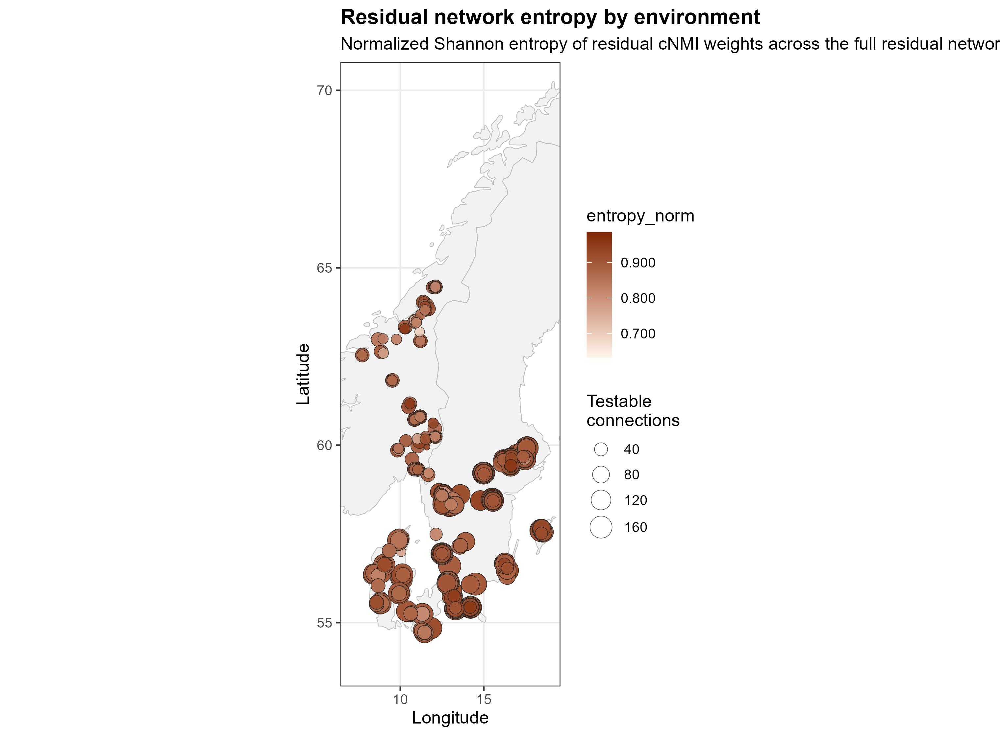
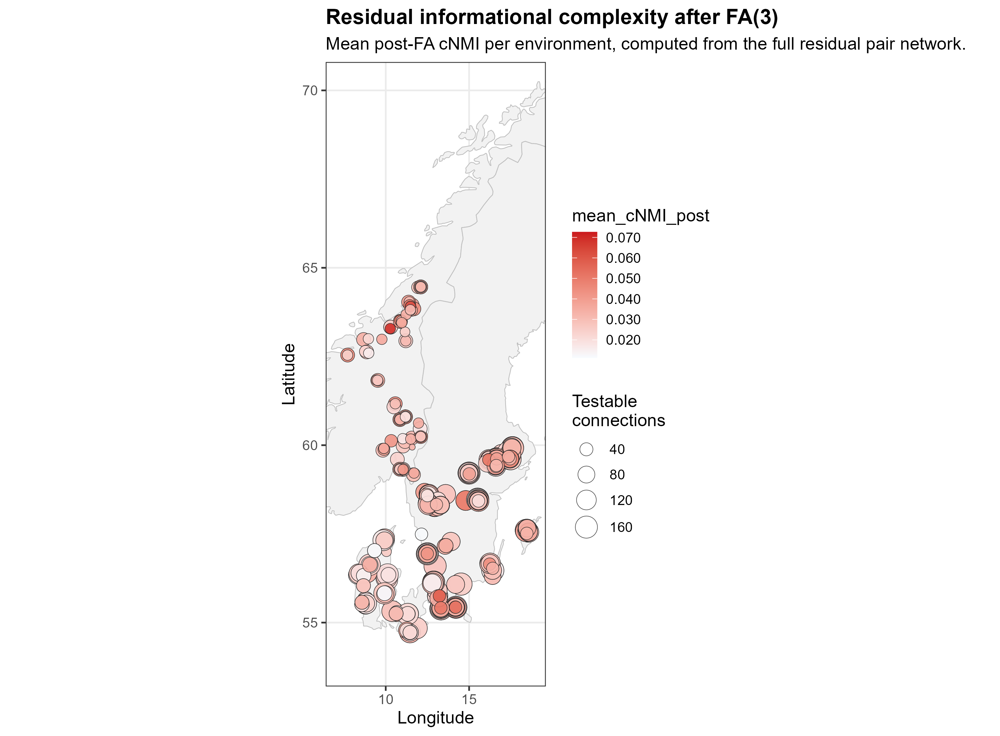
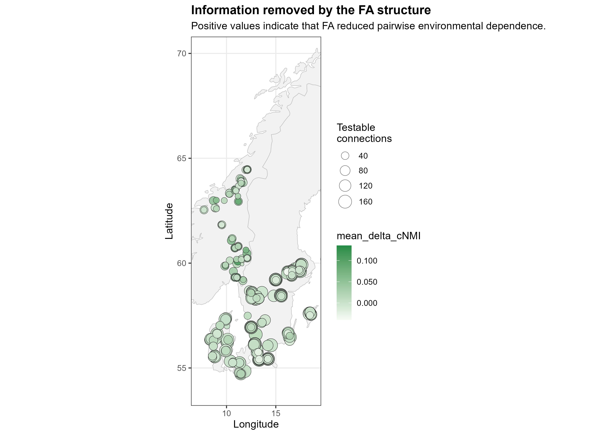
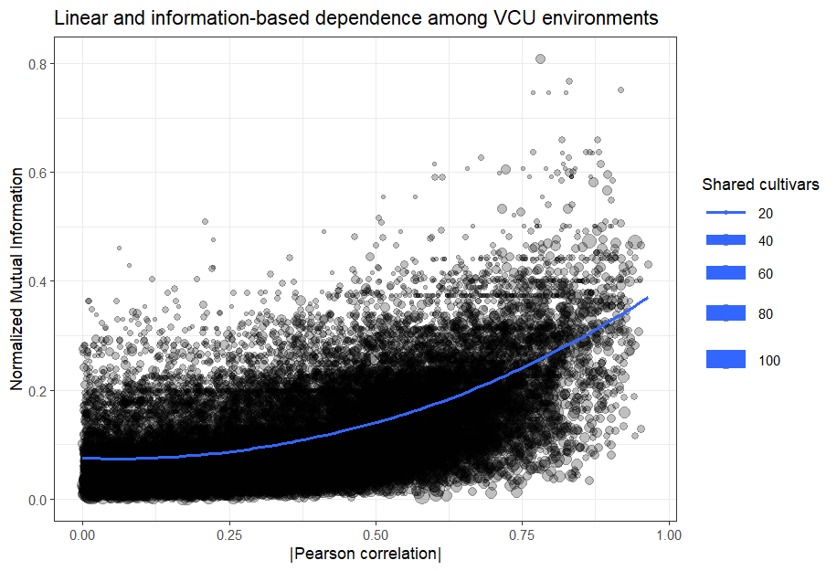
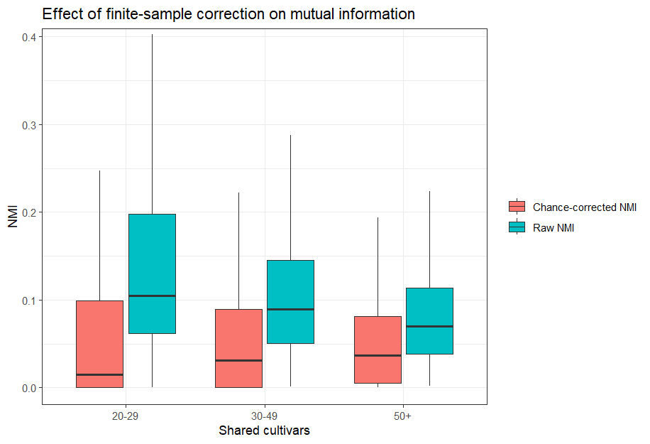
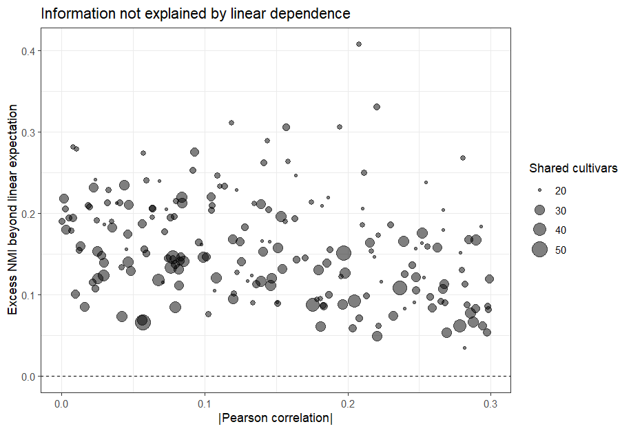

[[]{.bi .bi-github} Code on GitHub](https://github.com/raruizc/nordic-barley-fa-mi){.btn-pill .solid} [[]{.bi .bi-file-earmark-code} Methods document](https://github.com/raruizc/nordic-barley-fa-mi/blob/main/docs/methods.md){.btn-pill} [[]{.bi .bi-file-earmark-code} Results document](https://github.com/raruizc/nordic-barley-fa-mi/blob/main/docs/results.md){.btn-pill}

::: {.stats}
::: {.stat}
[26,028]{.stat-num}
[observations · 471 cultivars · 762 environments]{.stat-label}
:::
::: {.stat}
[92.75%]{.stat-num}
[of the cultivar × environment matrix is empty]{.stat-label}
:::
::: {.stat}
[0.31 vs 0.09]{.stat-num}
[median residual NMI vs matched linear null]{.stat-label}
:::
::: {.stat}
[98.5%]{.stat-num data-count="98.5" data-suffix="%"}
[of selected pairs carry information beyond linear]{.stat-label}
:::
:::

## The question

Genotype-by-environment interaction (G×E) decides which cultivar to recommend where. **Factor-analytic (FA)** mixed models are the standard tool: they summarize how cultivars respond across many environments with a few latent factors. But FA is linear and low-rank. **How much dependence between environments is left after FA, is it non-linear, and where is it?**

The idea of this project is to treat FA modelling and information theory as **complementary layers**: FA captures the dominant linear structure, and mutual information plus entropy diagnose what remains.

## Pipeline architecture

```{mermaid}
flowchart LR
  A[Raw Nordic barley<br/>VCU trials 2014–2024] --> B[Stage I<br/>pairwise MI audit]
  B --> C[Chance correction<br/>by permutation]
  C --> D[Pure-linear null<br/>excess information]
  B --> E[Stage II<br/>predictive validation]
  E --> F[Stage IIIA<br/>FA readiness audit]
  F --> G[Stage IIIB<br/>reduced-rank FA models]
  G --> H[Stage IIIC<br/>MI on FA residuals]
  H --> I[Stage IIID<br/>entropy + spatial classes]
```

Each stage lives in its own folder (`analysis/stage_0X_.../`) with a README, canonical code and results, so any figure can be traced back to the script that made it.

## Theory

### 1. Relative performance within environment

National trial systems differ in yield level, so yield is standardized inside each environment $e$ for cultivar $g$:

$$
z_{ge} = \frac{y_{ge} - \bar y_e}{s_e}.
$$

### 2. Mutual information between environments

For two environments sharing enough cultivars, their standardized profiles are discretized into equal-frequency bins (3 in the main analysis) and compared with

$$
MI(X,Y) = \sum_{x,y} p(x,y)\,\log\frac{p(x,y)}{p(x)\,p(y)},
\qquad
NMI(X,Y) = \frac{MI(X,Y)}{\sqrt{H(X)\,H(Y)}} .
$$

### 3. Correcting the finite-sample bias

Raw NMI is biased upwards when few cultivars are shared. One profile is permuted $B = 199$ times, keeping sample size and marginal distributions fixed, and the chance level is subtracted:

$$
cNMI = \max\left\{0,\ NMI_{obs} - \overline{NMI}_{perm}\right\}.
$$

### 4. Is it more than correlation? The pure-linear null

For pairs with weak Pearson correlation but high cNMI, simulated data keep the **same Pearson correlation** but are otherwise linear. The excess information is

$$
eNMI = NMI_{obs} - \mathbb E\left[NMI_{\text{linear null}}\right].
$$

### 5. Reduced-rank factor-analytic model

After completing the sparse environment × cultivar matrix (nuclear-norm regularization with `softImpute`) and an SVD for the initial cultivar loadings, FA models of order $k = 1, 2, 3$ are fitted with `lme4`:

$$
z_{ge} = \alpha_g + \sum_{h=1}^{k} \lambda_{gh}\, w_{eh} + \varepsilon_{ge},
$$

where $\alpha_g$ is the cultivar mean (fixed), $\lambda_{gh}$ are the loadings from the SVD and $w_{eh}$ are random environmental scores.

::: {.callout-note}
## Precise about what this is
This is a **two-stage reduced-rank / PC-FA** model, not a single joint REML fit of a general FA covariance. And the sign of an FA axis is arbitrary: flipping both loadings and scores gives the same fit, so maps are read by relative position and magnitude.
:::

### 6. What FA removes, and how residual information is spread

Information removed by FA for an environment pair:

$$
\Delta cNMI_{e_1 e_2} = cNMI^{pre}_{e_1 e_2} - cNMI^{post}_{e_1 e_2}
\qquad (\text{not a proportion of variance}).
$$

For environment $e$, its positive residual links are normalized into a distribution, and Shannon entropy measures whether the dependence is **concentrated** in a few partners or **diffuse**:

$$
p_{ej} = \frac{cNMI_{ej}}{\sum_j cNMI_{ej}}, \qquad
H_e = -\sum_j p_{ej}\log p_{ej}, \qquad
H_e^{*} = \frac{H_e}{\log k_e}, \qquad
\text{effective partners} = e^{H_e}.
$$

## From the equations to R

Condensed excerpts of the repository scripts (comments translated). Hover over the numbers to link each line to its equation.

::: {.panel-tabset}
## Mutual information

```r
mi_fast <- function(x, y) {
  tab <- table(x, y)
  pxy <- tab / sum(tab)                       # <1>
  px  <- rowSums(pxy); py <- colSums(pxy)     # <1>
  expected <- outer(px, py)                   # <2>
  ok <- pxy > 0                               # <3>
  sum(pxy[ok] * log(pxy[ok] / expected[ok]))  # <4>
}
```
1. Joint $p(x,y)$ and marginals $p(x)$, $p(y)$ from the contingency table.
2. $p(x)\,p(y)$: what the joint distribution would be under independence.
3. Skip empty cells ($0 \log 0 = 0$).
4. $MI = \sum p(x,y)\log\frac{p(x,y)}{p(x)p(y)}$.

## Permutation correction

```r
validate_pair_mi <- function(env1, env2, M, B = 199, nbins = 3) {
  x <- M[, env1]; y <- M[, env2]
  ok <- complete.cases(x, y); x <- x[ok]; y <- y[ok]   # <1>
  xd <- discretize_pair(x, nbins); yd <- discretize_pair(y, nbins)  # <2>

  MI_obs  <- mi_fast(xd, yd)
  NMI_obs <- MI_obs / sqrt(entropy_fast(xd) * entropy_fast(yd))   # <3>

  MI_perm <- replicate(B, mi_fast(xd, sample(yd)))     # <4>
  MI_corrected <- max(0, MI_obs - mean(MI_perm))       # <5>
  # ... NMI, empirical p-value and diagnostics follow
}
```
1. Only cultivars tested in both environments.
2. Equal-frequency discretization into 3 classes.
3. $NMI = MI / \sqrt{H(X)H(Y)}$.
4. Null distribution: permuting $Y$ keeps $n$, class frequencies and marginal entropies.
5. $cNMI = \max\{0,\ NMI_{obs} - \overline{NMI}_{perm}\}$.

## Factor-analytic model

```r
fit_fa_order <- function(d, k, label) {
  fa_terms <- paste0("FA", seq_len(k))                   # <1>
  random_term <- paste0("(0 + ", paste(fa_terms, collapse = " + "),
                        " || Environment)")              # <2>
  form <- as.formula(paste("z_FA ~ 0 + variety +", random_term))  # <3>
  lme4::lmer(form, data = d, REML = TRUE, control = LMER_CONTROL)  # <4>
}
```
1. Columns `FA1..FAk` hold the cultivar loadings $\lambda_{gh}$ from the SVD.
2. `||` sets zero covariance between latent factors, a natural identification after the orthogonal SVD basis; `Environment` groups the random scores $w_{eh}$.
3. `variety` is fixed: $\alpha_g$.
4. REML fit; FA(1)–FA(3) are then compared by AIC, BIC, convergence and residual variance.

## Entropy

```r
compute_shannon_entropy <- function(w) {
  w <- w[is.finite(w) & w > 0]          # <1>
  p <- w / sum(w)                       # <2>
  h <- -sum(p * log(p))                 # <3>
  k <- length(p)
  tibble(entropy_shannon    = h,
         entropy_norm       = if (k > 1) h / log(k) else 0,  # <4>
         effective_partners = exp(h),                        # <5>
         concentration_hhi  = sum(p^2))
}
```
1. Positive residual cNMI links of one environment.
2. $p_{ej}$: share of each partner.
3. $H_e = -\sum p_{ej}\log p_{ej}$.
4. $H_e^{*} = H_e / \log k_e$: 1 means evenly spread, near 0 means concentrated.
5. $e^{H_e}$: how many "equally strong" partners the environment effectively has.
:::

## Results

- **FA(3)** had the lowest BIC in both subsets (FA10 and FA15). Residual variance fell from 0.617 (FA1) to 0.535 (FA3), and the three factors explained 38.8%, 31.2% and 30.0% of the common factor variance.
- Across 23,691 environment pairs, mean cNMI was 0.0300 before FA and 0.0271 after: **41.9% of pairs kept positive residual information**.
- Residual cNMI correlated only 0.345 with absolute Pearson correlation: information and correlation see different things.
- In the 200 preselected pairs, median residual NMI was **0.31 vs 0.09** under the matched linear null (98.5% with p ≤ 0.05). Because these pairs were preselected, this is not a prevalence over all pairs.
- **Norway** had the highest residual information and **Sweden** the most diffuse (highest-entropy) dependence.

::: {.callout-important}
## An honest negative result, kept on purpose
In Stage II, MI carried predictive signal but did **not** beat Pearson correlation as a global weight for predicting missing cultivar × environment cells. That is why MI is used here as a **structural diagnostic**, not as a universal replacement for correlation.
:::

::: {.panel-tabset}
## Entropy map

{.lightbox}

## Residual information

{.lightbox}

## Removed by FA

{.lightbox}

## Linear vs NMI

{.lightbox}

## Chance correction

{.lightbox}

## Beyond linear

{.lightbox}
:::

## Open-science practices

Raw data come from the open Nordic MET dataset (Aasen et al., 2026; DataverseNO, DOI 10.18710/IZ3EFE, CC BY 4.0), with an MD5 checksum to prove the file is unchanged. The repository includes `CITATION.cff`, Zenodo and CodeMeta metadata, a GitHub Actions validation workflow, a data dictionary, provenance notes and a one-command run (`Rscript scripts/run_all.R`).

**Skills shown:** multi-environment trial analysis, factor-analytic mixed models, permutation tests, matrix completion, information theory, spatial visualization, research software engineering.
