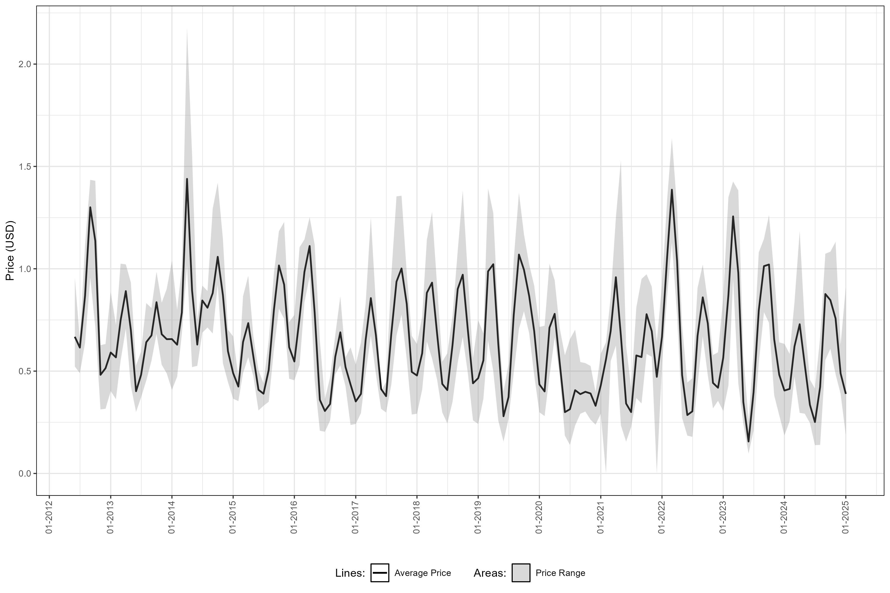
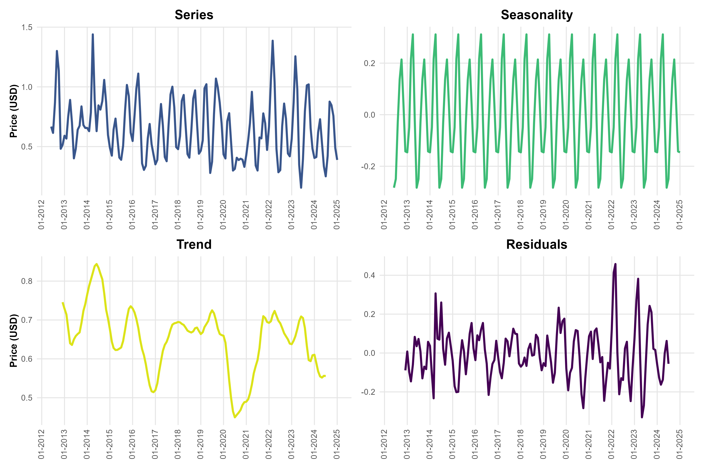
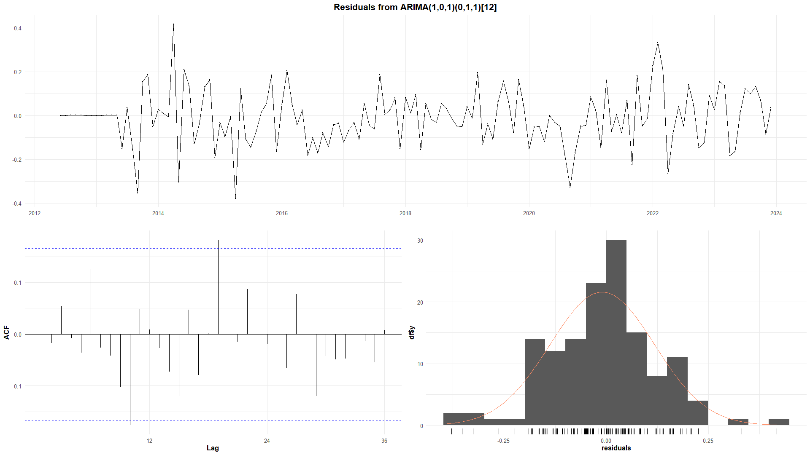
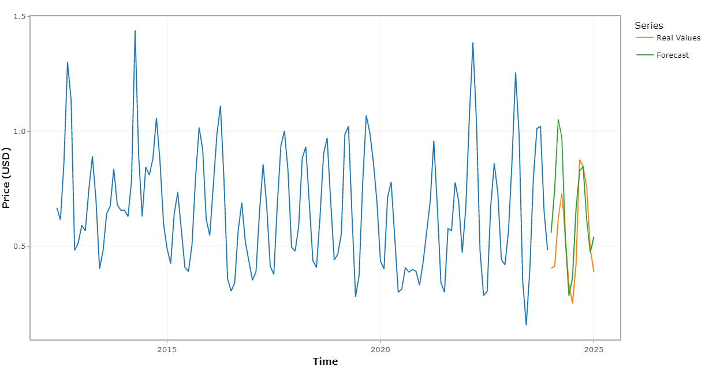
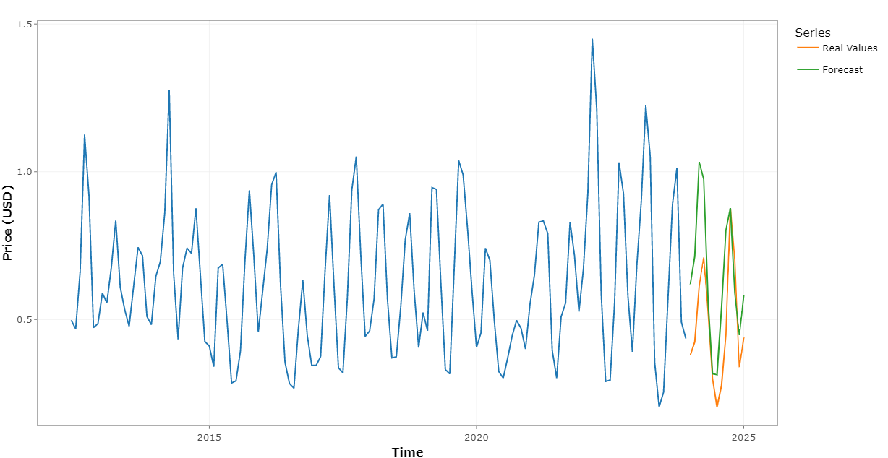
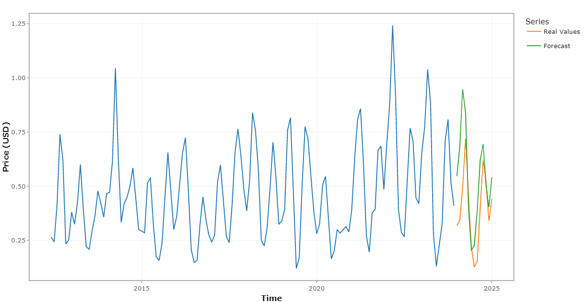

[[]{.bi .bi-github} Code on GitHub](https://github.com/raruizc/TahitiLemonPriceAnalysis){.btn-pill .solid} [[]{.bi .bi-file-earmark-code} Bogotá script](https://github.com/raruizc/TahitiLemonPriceAnalysis/blob/main/Scripts/01_Serie_Bogota_ENG.R){.btn-pill}

::: {.stats}
::: {.stat}
[3]{.stat-num}
[largest wholesale markets in Colombia]{.stat-label}
:::
::: {.stat}
[2012–2025]{.stat-num}
[monthly prices from SIPSA / DANE]{.stat-label}
:::
::: {.stat}
[4 models]{.stat-num}
[auto ARIMA, ARIMA, SARIMA, ARIMA-GARCH]{.stat-label}
:::
::: {.stat}
[13 months]{.stat-num}
[held-out test set (2024–Jan 2025)]{.stat-label}
:::
:::

## The problem

Tahiti lemon (*Citrus latifolia*) prices in Colombia swing with the harvest season. Farmers decide when to sell and traders decide when to buy, so both need to know **when prices peak** and **what to expect in the coming months**. This was the final project of my MBA in Data Science and Analytics (USP).

## Interactive forecasts

Zoom, hover and toggle series in the plots below (built with `plotly` in R).

::: {.panel-tabset}
## Bogotá

<iframe class="embed-frame" src="interactive/forecast-Bogota.html" loading="lazy" title="Interactive forecast, Bogotá"></iframe>

## Medellín

<iframe class="embed-frame" src="interactive/forecast-Medellin.html" loading="lazy" title="Interactive forecast, Medellín"></iframe>

## Bucaramanga

<iframe class="embed-frame" src="interactive/forecast-Bucaramanga.html" loading="lazy" title="Interactive forecast, Bucaramanga"></iframe>
:::

## Pipeline architecture

```{mermaid}
flowchart LR
  A[SIPSA / DANE<br/>monthly prices] --> B[COP → USD<br/>quantmod rates]
  B --> C[Spline interpolation<br/>of gaps]
  C --> D[ts object<br/>freq = 12]
  D --> E[Decomposition<br/>trend + season]
  D --> F[ADF tests<br/>differencing]
  F --> G{Train 2012–2023<br/>Test 2024–2025}
  G --> H[auto.arima]
  G --> I[Manual ARIMA]
  G --> J[SARIMA]
  G --> K[ARIMA-GARCH]
  H & I & J & K --> L[Diagnostics<br/>Ljung-Box · normality · ARCH]
  L --> M[Test RMSE / MAE / MAPE<br/>+ interactive plots]
```

## Theory

### 1. Decomposition

A monthly price series is split into trend $T_t$, seasonality $S_t$ and remainder $R_t$, additively or multiplicatively (when seasonal swings grow with the price level):

$$
y_t = T_t + S_t + R_t \qquad\text{or}\qquad y_t = T_t \times S_t \times R_t .
$$

### 2. Stationarity: Augmented Dickey-Fuller test

ARIMA models need a stationary series. The ADF regression tests for a unit root ($H_0: \gamma = 0$, non-stationary):

$$
\Delta y_t = \alpha + \beta t + \gamma\, y_{t-1} + \sum_{i=1}^{p}\delta_i\,\Delta y_{t-i} + \varepsilon_t .
$$

If $H_0$ is not rejected, the series is differenced ($\Delta y_t = y_t - y_{t-1}$) and tested again.

### 3. Seasonal ARIMA

With the backshift operator $B y_t = y_{t-1}$ and season length $s = 12$, a SARIMA$(p,d,q)(P,D,Q)_{12}$ model is

$$
\Phi_P(B^{s})\,\phi_p(B)\,(1-B)^{d}(1-B^{s})^{D}\,y_t \;=\; \Theta_Q(B^{s})\,\theta_q(B)\,\varepsilon_t,
\qquad \varepsilon_t \sim WN(0,\sigma^2),
$$

where $\phi_p, \theta_q$ are the short-term AR and MA polynomials and $\Phi_P, \Theta_Q$ their seasonal counterparts. The models compared were selected by `auto.arima` (AICc search), ARIMA$(1,0,1)(0,1,1)_{12}$ and SARIMA$(2,1,1)(2,1,1)_{12}$.

### 4. Residual diagnostics

A good model leaves white-noise residuals. The **Ljung-Box** statistic tests for leftover autocorrelation up to lag $h$:

$$
Q = n(n+2)\sum_{k=1}^{h}\frac{\hat\rho_k^{2}}{n-k} \;\sim\; \chi^2_{h-m}.
$$

The **ARCH LM test** checks whether the residual variance changes over time. If it does, a **GARCH(1,1)** models the conditional variance:

$$
\sigma_t^{2} = \omega + \alpha\,\varepsilon_{t-1}^{2} + \beta\,\sigma_{t-1}^{2}.
$$

### 5. Forecast accuracy on the test set

$$
\text{RMSE} = \sqrt{\tfrac{1}{h}\textstyle\sum_t (y_t-\hat y_t)^2},\qquad
\text{MAE} = \tfrac{1}{h}\textstyle\sum_t |y_t-\hat y_t|,\qquad
\text{MAPE} = \tfrac{100}{h}\textstyle\sum_t \left|\tfrac{y_t-\hat y_t}{y_t}\right| .
$$

## From the equations to R

Condensed from `01_Serie_Bogota_ENG.R`. Hover over the numbers to link each line to the theory above.

```r
prices_ts   <- ts(complete_data[, 8], start = c(2012, 6),
                  end = c(2025, 1), frequency = 12)          # <1>
decompose(prices_ts, type = "multiplicative")               # <2>

price_train <- window(prices_ts, start = c(2012, 6), end = c(2023, 12))  # <3>
price_test  <- window(prices_ts, start = c(2024, 1), end = c(2025, 1))   # <3>

adf.test(prices_ts, alternative = "stationary")             # <4>
adf.test(diff(prices_ts))                                   # <4>

arima_auto <- auto.arima(price_train, trace = TRUE)         # <5>
sarima     <- Arima(price_train, order = c(2, 1, 1),
                    seasonal = c(2, 1, 1))                  # <6>

checkresiduals(sarima)                                      # <7>
ArchTest(residuals(sarima))                                 # <8>

fc <- forecast(sarima, h = length(price_test))
accuracy(fc, price_test)                                    # <9>

spec <- ugarchspec(variance.model = list(model = "sGARCH", garchOrder = c(1, 1)),
                   mean.model = list(armaOrder = c(2, 1)))  # <10>
garch <- ugarchfit(spec, data = price_train)
```
1. Monthly series ($s = 12$) of average prices in USD, after spline interpolation of missing months.
2. Decomposition $y_t = T_t \times S_t \times R_t$.
3. Train 2012–2023, test 2024–Jan 2025: the forecast is judged on months the model never saw.
4. ADF unit-root test on the series and on its first difference.
5. Automatic order search by AICc.
6. SARIMA$(2,1,1)(2,1,1)_{12}$: seasonal and non-seasonal differencing plus AR/MA terms.
7. Ljung-Box test and residual ACF/histogram.
8. ARCH LM test for changing variance.
9. Test-set RMSE, MAE and MAPE.
10. GARCH(1,1) for the conditional variance $\sigma_t^2 = \omega + \alpha\varepsilon_{t-1}^2 + \beta\sigma_{t-1}^2$.

## Figures

::: {.panel-tabset}
## Price series

{.lightbox}

## Decomposition

{.lightbox}

## Residuals

{.lightbox}

## Forecasts

::: {layout-ncol="3"}
{.lightbox group="fc"}

{.lightbox group="fc"}

{.lightbox group="fc"}
:::
:::

**Skills shown:** time-series modelling and diagnostics, forecasting and out-of-sample evaluation, volatility models, public economic data, interactive visualization (`plotly`), R (`forecast`, `tseries`, `urca`, `rugarch`, `fpp3`).
