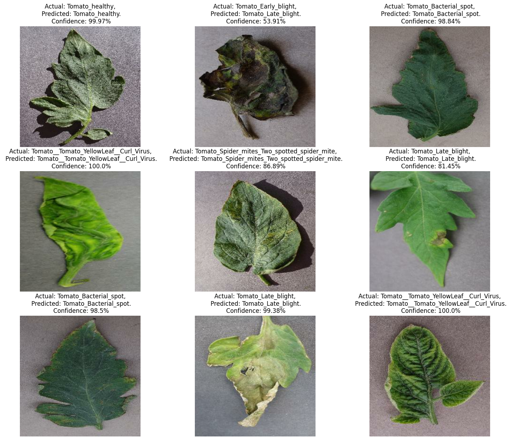
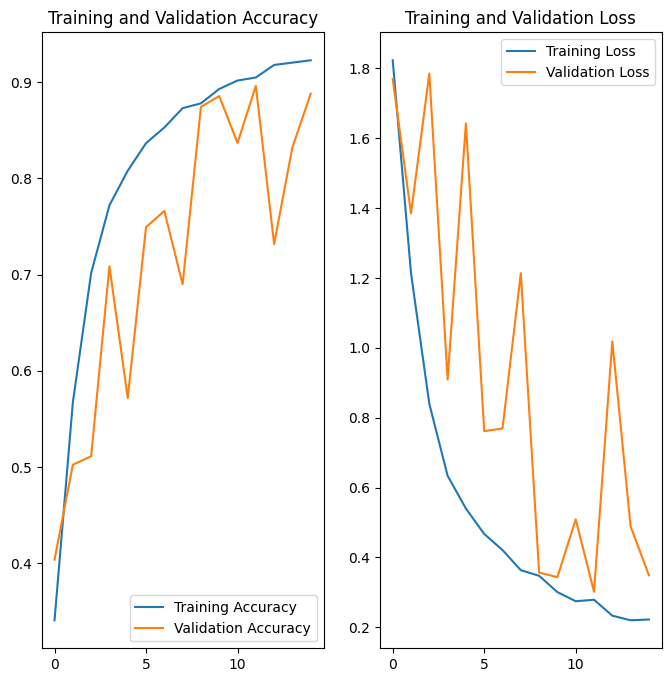

[[]{.bi .bi-github} Code on GitHub](https://github.com/raruizc/DiseaseIdentification){.btn-pill .solid} [[]{.bi .bi-journal-code} Training notebook](https://github.com/raruizc/DiseaseIdentification/blob/main/Training/TomatoDiseaseIdentification.ipynb){.btn-pill}

::: {.stats}
::: {.stat}
[88.8%]{.stat-num data-count="88.8" data-suffix="%"}
[validation accuracy (epoch 15)]{.stat-label}
:::
::: {.stat}
[16,011]{.stat-num}
[leaf images, 10 classes]{.stat-label}
:::
::: {.stat}
[184,202]{.stat-num}
[trainable parameters]{.stat-label}
:::
::: {.stat}
[720 KB]{.stat-num}
[model size, small enough for a phone]{.stat-label}
:::
:::

## The problem

Tomato leaf diseases spread fast, and diagnosing them in the field needs expertise that is not always available. A small image model could give **fast, low-cost screening from a single phone photo**, as a first step towards a field-ready diagnostic tool.

The model learns 10 classes from the public **PlantVillage** dataset: bacterial spot, early blight, late blight, leaf mold, Septoria leaf spot, spider mites, target spot, yellow leaf curl virus, mosaic virus and healthy leaves.

## Pipeline architecture

```{mermaid}
flowchart LR
  A[PlantVillage<br/>16,011 images] --> B[image_dataset_from_directory<br/>256×256 RGB, batch 32]
  B --> C{Shuffle + split<br/>80 / 10 / 10}
  C --> D[cache · shuffle · prefetch]
  D --> E[Resize + rescale 1/255]
  E --> F[Augmentation<br/>flips + rotation]
  F --> G[6 × Conv2D + MaxPool]
  G --> H[Flatten → Dense 64]
  H --> I[Softmax · 10 classes]
  I --> J[Adam + cross-entropy<br/>15 epochs]
  J --> K[SavedModel export<br/>model/1]
```

Resizing, rescaling and augmentation are **layers inside the model**, so the exported model takes a raw photo and does its own preprocessing. Augmentation layers are active only during training.

## Theory

### 1. Convolution: learning local patterns

A convolutional layer slides small filters over the image. For filter $k$ with weights $\mathbf W^{(k)}$ (size $3\times3\times C_{in}$) and bias $b_k$, the output at position $(i,j)$ is

$$
z^{(k)}_{ij} = \sum_{u=0}^{2}\sum_{v=0}^{2}\sum_{c=1}^{C_{in}} W^{(k)}_{u v c}\; x_{i+u,\, j+v,\, c} + b_k ,
\qquad a^{(k)}_{ij} = \operatorname{ReLU}\!\left(z^{(k)}_{ij}\right) = \max\!\left(0, z^{(k)}_{ij}\right).
$$

Early filters respond to edges and colour changes; deeper ones combine them into lesion shapes, spots and textures.

### 2. Max-pooling: keep the strongest signal

A $2\times2$ max-pool keeps the largest activation in each block, halving height and width:

$$
p_{ij} = \max_{(u,v)\in\{0,1\}^2} a_{2i+u,\; 2j+v}.
$$

This makes the features more robust to small shifts of the lesion in the photo.

### 3. Sizes and parameter count

With no padding, a $3\times3$ convolution reduces each side by 2, and pooling halves it (rounding down). Each convolution has $(3\cdot3\cdot C_{in}+1)\,C_{out}$ parameters:

$$
n_{\text{out}} = \left\lfloor \frac{n_{\text{in}} - 2}{2} \right\rfloor ,
\qquad
\#\theta_{\text{conv}} = (9\,C_{in} + 1)\,C_{out}.
$$

| Block | Output size | Parameters |
|---|---|---|
| Input | 256 × 256 × 3 | 0 |
| Conv 32 + pool | 127 × 127 × 32 | 896 |
| Conv 64 + pool | 62 × 62 × 64 | 18,496 |
| Conv 64 + pool | 30 × 30 × 64 | 36,928 |
| Conv 64 + pool | 14 × 14 × 64 | 36,928 |
| Conv 64 + pool | 6 × 6 × 64 | 36,928 |
| Conv 64 + pool | 2 × 2 × 64 | 36,928 |
| Flatten → Dense 64 | 64 | 16,448 |
| Dense 10 (softmax) | 10 | 650 |
| **Total** | | **184,202** |

Six convolution blocks shrink a 256 × 256 photo to a 2 × 2 × 64 summary, so the dense layers stay tiny. That is why the whole model is only about 720 KB.

### 4. Softmax and cross-entropy

The last layer turns the 10 scores $z_k$ into probabilities, and training minimizes the cross-entropy between the predicted probability and the true class $y$:

$$
\hat p_k = \frac{e^{z_k}}{\sum_{j=1}^{10} e^{z_j}},
\qquad
\mathcal L = -\frac{1}{N}\sum_{n=1}^{N} \log \hat p_{n,\,y_n}.
$$

"Sparse" categorical cross-entropy means the labels are integers (0–9) instead of one-hot vectors.

### 5. Adam optimizer

Adam updates every weight with running averages of the gradient $g_t$ and its square, so each parameter gets its own step size:

$$
\begin{aligned}
m_t &= \beta_1 m_{t-1} + (1-\beta_1)\, g_t, &
v_t &= \beta_2 v_{t-1} + (1-\beta_2)\, g_t^2, \\
\hat m_t &= \frac{m_t}{1-\beta_1^t}, &
\hat v_t &= \frac{v_t}{1-\beta_2^t}, \\
\theta_t &= \theta_{t-1} - \eta\, \frac{\hat m_t}{\sqrt{\hat v_t} + \epsilon}, &
&(\eta = 0.001,\ \beta_1 = 0.9,\ \beta_2 = 0.999).
\end{aligned}
$$

### 6. Data augmentation

Random horizontal and vertical flips and rotations of up to ±20% of a full turn (±72°) create new versions of each leaf in every epoch. The disease does not change when the leaf is flipped or turned, so the model learns to ignore orientation and overfits less.

## Interactive: how the image shrinks

Move the slider to change the input size and watch how each block reduces the image and how many parameters the dense layer needs.

```{ojs}
//| echo: false
viewof imgSize = Inputs.range([128, 512], {step: 32, value: 256, label: "Input size (pixels)"})
layersTbl = {
  const filters = [32, 64, 64, 64, 64, 64];
  let n = imgSize, cin = 3, rows = [{block: "Input", size: `${n} × ${n} × 3`, params: 0}];
  for (const [i, f] of filters.entries()) {
    n = Math.floor((n - 2) / 2);
    rows.push({block: `Conv ${f} + pool (${i + 1})`, size: `${n} × ${n} × ${f}`, params: (9 * cin + 1) * f});
    cin = f;
  }
  const flat = n * n * 64;
  rows.push({block: "Flatten → Dense 64", size: `${flat} → 64`, params: flat * 64 + 64});
  rows.push({block: "Dense 10 (softmax)", size: "10", params: 650});
  return rows;
}
Inputs.table(layersTbl, {
  columns: ["block", "size", "params"],
  header: {block: "Block", size: "Output", params: "Parameters"},
  format: {params: d => d.toLocaleString("en-US")},
  sort: null, rows: 12
})
md`**Total parameters: ${layersTbl.reduce((s, r) => s + r.params, 0).toLocaleString("en-US")}**, about ${(layersTbl.reduce((s, r) => s + r.params, 0) * 4 / 1024).toFixed(0)} KB of 32-bit weights.`
```

## From the theory to Python

Condensed from the training notebook. Hover over the numbers to link each line to the theory.

```python
dataset = tf.keras.preprocessing.image_dataset_from_directory(
    "PlantVillage", shuffle=True,
    image_size=(256, 256), batch_size=32)                     # <1>
train_ds, val_ds, test_ds = get_dataset_partitions_tf(dataset)  # <2>
train_ds = train_ds.cache().shuffle(1000).prefetch(tf.data.AUTOTUNE)  # <3>

resize_and_rescale = tf.keras.Sequential([
    layers.Resizing(256, 256), layers.Rescaling(1./255)])     # <4>
data_augmentation = tf.keras.Sequential([
    layers.RandomFlip("horizontal_and_vertical"),
    layers.RandomRotation(0.2)])                              # <5>

model = models.Sequential([
    resize_and_rescale, data_augmentation,
    layers.Conv2D(32, (3, 3), activation="relu"),             # <6>
    layers.MaxPooling2D((2, 2)),                              # <7>
    # ... 5 more blocks of Conv2D(64, 3×3) + MaxPooling2D
    layers.Flatten(),
    layers.Dense(64, activation="relu"),
    layers.Dense(10, activation="softmax")])                  # <8>

model.compile(optimizer="adam",                               # <9>
              loss=tf.keras.losses.SparseCategoricalCrossentropy(),  # <10>
              metrics=["accuracy"])
history = model.fit(train_ds, epochs=15, validation_data=val_ds)
model.export("../model/1")                                    # <11>
```
1. Reads the class folders and labels each image by its folder name: 256 × 256 RGB, batches of 32.
2. Shuffles with a fixed seed (2024) and splits 80% / 10% / 10% into train, validation and test.
3. Keeps images in memory and loads the next batch while the GPU trains on the current one.
4. Pixel values from 0–255 to 0–1, inside the model.
5. Random flips and rotations of ±20% of a turn (section 6).
6. 32 filters of 3 × 3 with ReLU: equation in section 1.
7. 2 × 2 max-pooling: section 2.
8. Softmax over 10 classes: section 4.
9. Adam optimizer: section 5.
10. Cross-entropy with integer labels: section 4.
11. Exports a TensorFlow SavedModel, ready for TensorFlow Serving or a FastAPI app.

## Results

::: {.panel-tabset}
## Predictions

{.lightbox}

## Training curves

{.lightbox}
:::

| Metric | Value |
|---|---|
| Training accuracy (epoch 15) | 92.2% |
| **Validation accuracy (epoch 15)** | **88.8%** |
| Parameters | 184,202 (≈ 720 KB) |

Validation accuracy oscillates between epochs, which suggests the learning rate is high for this architecture.

## Limitations and next steps

- **Report the test set.** The notebook evaluates the held-out 10% test set; the next version will report that accuracy and a **per-class confusion matrix** to see which diseases are confused.
- **Stabilize training** with `EarlyStopping` and `ReduceLROnPlateau` callbacks.
- **Field photos are harder.** PlantVillage images have plain backgrounds; real field photos have soil, shadows and several leaves. Testing on field images is essential before any real use.
- **Transfer learning** (MobileNetV3, EfficientNet) would likely improve accuracy with a similar model size.
- **Deploy** as a small web app (FastAPI or TensorFlow.js) so a farmer can upload a photo.

**Skills shown:** deep learning, convolutional networks, image data pipelines, model sizing, model export for deployment, Python (TensorFlow/Keras).
